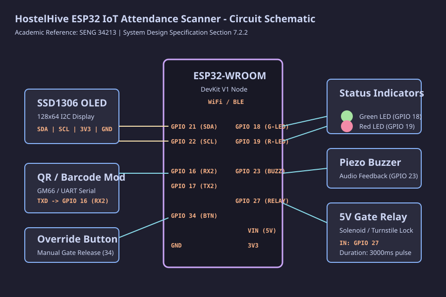

import { Aside } from '@astrojs/starlight/components';

## Parts

You need an ESP32-WROOM-32 DevKit V1 (the 30-pin and 38-pin versions both work), a 0.96 inch SSD1306 OLED (128 by 64, I2C), and a UART barcode module such as the GM66 or the Waveshare scanner.

For feedback, add one green and one red 5 mm LED and an active piezo buzzer. The lock is driven by a 5 V single-channel relay module with an optocoupler, which switches the solenoid or turnstile. The manual override is an ordinary push button plus a 10 kΩ resistor. A 5 V 2 A supply powers the lot.

## Pinout

| Part | GPIO | Notes |
| --- | --- | --- |
| OLED SDA | 21 | I2C data, 3.3 V |
| OLED SCL | 22 | I2C clock, 3.3 V |
| Green LED | 18 | High = on |
| Red LED | 19 | High = on |
| Buzzer | 23 | PWM. 2400 Hz for success, 450 Hz for alerts |
| Gate relay | 27 | High = open. 3 second pulse |
| Scanner, into the ESP32 | 16 (RX2) | From the scanner's TX |
| Scanner, out of the ESP32 | 17 (TX2) | Configuration commands |
| Override button | 34 | Low = pressed. Needs the external pull-up |

<Aside type="danger">GPIO 34 has no internal pull-up resistor. Wire the 10 kΩ resistor from GPIO 34 to 3.3 V. Without it the pin floats and the gate can open on its own.</Aside>

The diagram above is [`docs/circuit_diagram.svg`](https://github.com/Hostel-Hive/hostelhive-hardware/blob/main/docs/circuit_diagram.svg) from the hardware repository.
